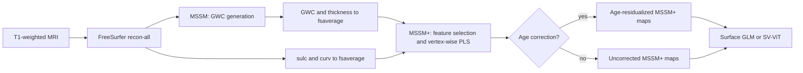

# MSSM\+
Improved Multiscale Structural Mapping with Surface Vision Transformer for the Detection of Alzheimer's Disease Neurodegeneration Repository

This repository contains code for the Supervertex Vision Transformer (SV-ViT) and patches map partitioning cortical surface.

---

## Repository structure

- `configs/`
  - `MSSMp.yaml`: configuration for cortical surface partitioning and CSV-map generation.
  - `sv-vit.yaml`: configuration for training/evaluation.
- `data/`
  - `triangle_indices_ico_7_sub_ico_3.csv`: SV maps (concatenated lh and rh hemisphere).
- `scripts/`
  - `pls_age_correction.py`: perform MSSM+ procedure (with pls and age correction)
  - `surf2fsaverage.sh`: map FreeSurfer `sulc` and `curv` to `fsaverage`
  - `test.sh` `test_0_mssm.sh`: MSSM+ pipeline with group analysis
  - `train_age_correction_model.py`: code for training age correction models
  - `train-sv-vit.py`: train and evaluate SV-ViT
- `requirements.txt`: minimal Python dependencies.

---

## Setup

```bash
python -m venv .venv
source .venv/bin/activate
pip install -r requirements.txt
```

---

## 📖 BibTeX (to cite our paper)

```bibtex
@article{baek2026mssmplus,
  title={Improved Multiscale Structural Mapping with Supervertex Vision Transformer for the Detection of Alzheimer's Disease Neurodegeneration},
  author={Baek, Geonwoo and Salat, David H. and Jang, Ikbeom and {Alzheimer's Disease Neuroimaging Initiative}},
  journal={Human Brain Mapping},
  volume={47},
  number={8},
  pages={e70548},
  year={2026},
  publisher={Wiley Online Library},
  doi={10.1002/hbm.70548}
}
```

---

## FreeSurfer `sulc`/`curv` to `fsaverage`

MSSM+ combines the MSSM gray/white contrast (GWC) maps with morphometry on a common surface. FreeSurfer's `recon-all` creates `lh.sulc`, `rh.sulc`, `lh.curv`, and `rh.curv` in each subject's native surface space. Before MSSM+ reads them, these four files must be resampled through each subject's `sphere.reg` onto `fsaverage`.

[`scripts/surf2fsaverage.sh`](scripts/surf2fsaverage.sh) performs only that operation. It is a focused version of the local MSSM extension `ext-code-new/run_fsavg_from_recondirs.sh`: unlike that source script, it deliberately does **not** map `jacobian_white`, `pial_lgi`, thickness, or GWC files.

### Requirements

- A completed FreeSurfer `recon-all` subject with `surf/{lh,rh}.sphere.reg`, `surf/{lh,rh}.sulc`, and `surf/{lh,rh}.curv`.
- FreeSurfer initialized so that `mri_surf2surf` is on `PATH` and `FREESURFER_HOME` is set.
- The recon-all subject must be an immediate child of its FreeSurfer `SUBJECTS_DIR`.

```bash
export FREESURFER_HOME=/path/to/freesurfer
source "$FREESURFER_HOME/SetUpFreeSurfer.sh"

bash scripts/surf2fsaverage.sh \
  -r /data/recons/sub-001
```

The script sets `SUBJECTS_DIR` from the parent of `-r`. If that directory does not already contain `fsaverage`, it links `$FREESURFER_HOME/subjects/fsaverage`. Existing outputs are skipped; pass `--force` to regenerate them.

Outputs are written beside the native files:

```text
/data/recons/sub-001/surf/
├── lh.fsaverage.sulc
├── rh.fsaverage.sulc
├── lh.fsaverage.curv
└── rh.fsaverage.curv
```

Run multiple subjects sequentially:

```bash
SUBJECTS_DIR=/data/recons
for recon_dir in "$SUBJECTS_DIR"/sub-*; do
  bash scripts/surf2fsaverage.sh -r "$recon_dir"
done
```

Or, when GNU Parallel is available:

```bash
find /data/recons -mindepth 1 -maxdepth 1 -type d ! -name fsaverage -print0 \
  | parallel -0 -j 8 bash scripts/surf2fsaverage.sh -r {}
```

### Quick output check

```bash
for hemi in lh rh; do
  for feature in sulc curv; do
    test -s "/data/recons/sub-001/surf/${hemi}.fsaverage.${feature}" \
      || echo "missing: ${hemi}.fsaverage.${feature}"
  done
done
```

## End-to-end workflow: MSSM to MSSM+

The two repositories are consecutive stages, not alternatives:



The public source repositories are [jibikbam/MSSM](https://github.com/jibikbam/MSSM) and [labhai/MSSMplus](https://github.com/labhai/MSSMplus).

### 1. Run FreeSurfer

All subjects must use the same FreeSurfer version and the same `fsaverage` template.

```bash
export SUBJECTS_DIR=/data/recons
recon-all -sd "$SUBJECTS_DIR" -s sub-001 -i /data/T1/sub-001_T1w.nii.gz -all
```

Do FreeSurfer QC before continuing. At minimum, confirm that `recon-all` completed and that both hemispheres have `white`, `pial`, `sphere.reg`, `thickness`, `sulc`, and `curv` files.

### 2. Run MSSM preprocessing

From the MSSM repository's `code/` directory, `mssm.sh` generates the multi-depth GWC maps, maps GWC and thickness to `fsaverage`, optionally creates smoothed copies, and checks the result.

```bash
cd /path/to/MSSM/code
bash mssm.sh /data/recons 16 'sub-*' 0
```

The arguments are:

1. FreeSurfer `SUBJECTS_DIR`.
2. Available logical CPU count. The current MSSM shell implementation should be given at least 14.
3. Subject-name shell pattern; quote it so the calling shell does not expand it early.
4. Surface smoothing FWHM in millimetres.

For the default MSSM+ prefixes below, the important unsmoothed outputs are:

```text
<subject>/mri/GWC/reg_surf2fsaverage/<GWC files>
<subject>/surf/reg_surf2fsaverage/lh.thickness
<subject>/surf/reg_surf2fsaverage/rh.thickness
```

MSSM also writes `reg_surf2fsaverage_smoothed<FWHM>mm` directories. Use those only if the MSSM+ prefixes are changed accordingly. The usual MSSM+ flow reads unsmoothed inputs and applies `FWHM` after producing the combined map, avoiding accidental double smoothing.

### 3. Add `sulc` and `curv`

Run the script in the previous section for every recon-all subject. After steps 2 and 3, a subject consumed by the default MSSM+ configuration has this minimum layout:

```text
<subject>/
├── mri/GWC/reg_surf2fsaverage/
│   ├── lh_subcortwm-0.5divgm.2.nii.gz
│   ├── rh_subcortwm-0.5divgm.2.nii.gz
│   └── ...
└── surf/
    ├── reg_surf2fsaverage/lh.thickness
    ├── reg_surf2fsaverage/rh.thickness
    ├── lh.fsaverage.sulc
    ├── rh.fsaverage.sulc
    ├── lh.fsaverage.curv
    └── rh.fsaverage.curv
```

`jacobian_white` and `pial_lgi` remain optional, separate preprocessing products. For the focused GWC + thickness + sulc + curv flow documented here, leave them out of `CAND_TYPES`. Include them only when those files have been generated and mapped independently.

### 4. Arrange the MSSM+ dataset and metadata

`pls_age_correction.py` resolves each subject as:

```text
<DATA_DIR>/<Split>/<Group>/<Subject>/
```

The simplest approach is to symlink each completed recon-all directory into that layout instead of copying it:

```bash
mkdir -p /datasets/All/AD /datasets/All/CN
ln -s /data/recons/sub-001 /datasets/All/AD/sub-001
ln -s /data/recons/sub-002 /datasets/All/CN/sub-002
```

With that example layout, set `DATA_DIR: /datasets` and `SPLITS: [All]`. `INFO_PATH` must point to a CSV containing at least these columns:

```csv
Subject,Age,Group,Split
sub-001,74,AD,All
sub-002,72,CN,All
```

Subject IDs, `Group` values, and `Split` values must exactly match the directory names and the configured `GROUPS`/`SPLITS`. Both hemispheres must use fsaverage (163,842 vertices each for the default `N_VERTEX: 327684`).

### 5. Configure and generate MSSM+ maps

Copy `configs/MSSMp.yaml` to an experiment-specific YAML and replace all empty/site-specific paths. The checked-in script also reads `RESULTS_ROOT` and `WEIGHTS_PATHS`, which are not present in the current template, so add them to the experiment YAML. In particular, check:

- `DATA_DIR`, `INFO_PATH`, `RESULTS_ROOT`, and optionally `MAP_DIR`.
- `THICK_PREFIX: surf/reg_surf2fsaverage` and `GWR_PREFIX: mri/GWC/reg_surf2fsaverage`.
- `CAND_PREFIX: surf`, so `sulc` and `curv` resolve to `surf/lh.fsaverage.sulc`, etc.
- `CAND_TYPES`, `MSSM_CANDIDATES`, `N_VERTEX`, `GROUPS`, and `SPLITS` against the features and cohort actually present.
- `SAVE: true` if intermediate dataset/reduction/correction pickle files should be retained.

For the focused pipeline that needs no `jacobian_white` or `pial_lgi`, use this feature portion:

```yaml
DATA_DIR: /datasets
INFO_PATH: /datasets/info/info.csv
RESULTS_ROOT: /results/my_experiment
MAP_DIR: /results/my_experiment/map
WEIGHTS_PATHS: []  # compatibility key read by the current script

N_FEATURES: 11     # 8 GWC + thickness + sulc + curv
N_VERTEX: 327684

CAND_TYPES:
  - sulc
  - curv

MSSM_CANDIDATES:
  - "1111"
```

With this reduced `CAND_TYPES`, the four candidate bits are:

| Bit | Feature block | Bilateral channels |
| --- | --- | ---: |
| 1 | GWC | 8 |
| 2 | thickness | 1 |
| 3 | sulc | 1 |
| 4 | curv | 1 |

Thus `1111` selects GWC + thickness + sulc + curv, while `0011` selects only sulc + curv. Keep the candidate string length consistent with `CAND_TYPES`; the feature mask is constructed from that length.

Then run one candidate and split from the repository root:

```bash
python scripts/pls_age_correction.py \
  --config configs/my-MSSMp.yaml \
  --mssm_cand 1111 \
  --split All
```

This stage loads the fsaverage-aligned GWC/morphometry arrays, applies the candidate feature mask, performs vertex-wise PLS when more than one feature is selected, optionally removes the age effect, and writes per-subject plus concatenated FreeSurfer maps below `MAP_DIR/<Split>/<candidate>/`.

Candidate strings are feature-selection masks and must match the feature order implemented by the experiment configuration/code. The checked-in `sv-vit.yaml` shows a legacy six-bit example; change its `CANDIDATES` to `1111` for the focused four-block pipeline above. Verify feature order and a small generated dataset before launching a large run.

### 6. Choose the age-correction branch

#### With age correction

Use a correction model trained on an appropriate reference cohort. Configure:

```yaml
CORRECTION: true
WEIGHTS_DIR: /path/to/age-correction/weights
NTH: 1
```

For candidate `1111` and `NTH: 1`, `pls_age_correction.py` expects:

```text
<WEIGHTS_DIR>/polynomial-1-post-1111.pkl
```

Generate compatible weights with `scripts/train_age_correction_model.py` and its experiment-specific training configuration before running the map-generation command. The correction cohort, feature order, candidate, polynomial degree, vertex count, and FreeSurfer template must match the application cohort.

#### Without age correction

No correction-model training or weight file is needed. Set **both** values below:

```yaml
CORRECTION: false
WEIGHTS_DIR: ""
```

`CORRECTION: false` makes MSSM+ pass the PLS result through unchanged. `WEIGHTS_DIR` must also be empty because the current main routine tries to load a weight file whenever `WEIGHTS_DIR` is non-empty, before it reaches the correction bypass.

The no-correction flow is therefore:

```text
recon-all
  -> MSSM GWC/thickness fsaverage mapping
  -> sulc/curv fsaverage mapping
  -> candidate feature selection
  -> vertex-wise PLS
  -> uncorrected MSSM+ surface maps
  -> surface statistics or SV-ViT
```

Age should still be retained in the metadata even when correction is disabled so that it can be used as a covariate or for stratified/sensitivity analyses downstream.

### 7. Downstream analysis

- Surface statistics: smooth the resulting `.mssm` maps at the chosen FWHM and run the FreeSurfer GLM/permutation workflow.
- SV-ViT: point an experiment copy of `configs/sv-vit.yaml` at the generated `lh_concat.mgh`/`rh_concat.mgh`, metadata CSV, and supervertex triangle-index CSV; set `CANDIDATES: ["1111"]` for the focused pipeline; then run `scripts/train-sv-vit.py` in the environment containing the model dependencies.

Keep preprocessing choices identical across training, validation, and test subjects: FreeSurfer version/template, native-to-fsaverage registration, feature list/order, smoothing, PLS definition, and age-correction branch are all part of the model specification.
