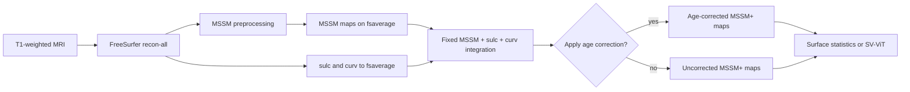

# MSSM\+
Improved Multiscale Structural Mapping with Surface Vision Transformer for the Detection of Alzheimer's Disease Neurodegeneration Repository

This repository contains code for the Supervertex Vision Transformer (SV-ViT) and patches map partitioning cortical surface.

---

## Repository structure

- `configs/`
  - `MSSMp.yaml`: configuration for cortical surface partitioning and CSV-map generation.
  - `sv-vit.yaml`: configuration for training/evaluation.
- `data/`
  - `triangle_indices_ico_7_sub_ico_3.csv`: SV maps (concatenated lh and rh hemisphere).
- `scripts/`
  - `pls_age_correction.py`: perform the MSSM+ procedure with optional age correction.
  - `surf2fsaverage.sh`: map FreeSurfer `sulc` and `curv` to `fsaverage`.
  - `test.sh` `test_0_mssm.sh`: MSSM+ pipeline with group analysis.
  - `train_age_correction_model.py`: train age-correction models.
  - `train-sv-vit.py`: train and evaluate SV-ViT.
- `requirements.txt`: minimal Python dependencies.

---

## Setup

```bash
python -m venv .venv
source .venv/bin/activate
pip install -r requirements.txt
```

---

## 📖 BibTeX (to cite our paper)

```bibtex
@article{baek2026mssmplus,
  title={Improved Multiscale Structural Mapping with Supervertex Vision Transformer for the Detection of Alzheimer's Disease Neurodegeneration},
  author={Baek, Geonwoo and Salat, David H. and Jang, Ikbeom and {Alzheimer's Disease Neuroimaging Initiative}},
  journal={Human Brain Mapping},
  volume={47},
  number={8},
  pages={e70548},
  year={2026},
  publisher={Wiley Online Library},
  doi={10.1002/hbm.70548}
}
```

---

## Map `sulc` and `curv` to `fsaverage`

MSSM+ uses one fixed input combination: **MSSM + sulc + curv**. FreeSurfer's `recon-all` produces `sulc` and `curv` in each subject's native surface space, so they must be resampled to the same `fsaverage` space used by MSSM before running MSSM+.

[`scripts/surf2fsaverage.sh`](scripts/surf2fsaverage.sh) performs only this resampling. It maps:

- `lh.sulc` and `rh.sulc`
- `lh.curv` and `rh.curv`

It does not process `jacobian_white`, `pial_lgi`, thickness, or GWC files.

### Requirements

- A completed FreeSurfer `recon-all` subject.
- `surf/{lh,rh}.sphere.reg`, `surf/{lh,rh}.sulc`, and `surf/{lh,rh}.curv` in the subject directory.
- FreeSurfer initialized so that `mri_surf2surf` is on `PATH` and `FREESURFER_HOME` is set.
- The subject directory must be an immediate child of its FreeSurfer `SUBJECTS_DIR`.

### Run one subject

```bash
export FREESURFER_HOME=/path/to/freesurfer
source "$FREESURFER_HOME/SetUpFreeSurfer.sh"

bash scripts/surf2fsaverage.sh \
  -r /data/recons/sub-001
```

The script derives `SUBJECTS_DIR` from the parent of `-r`. If `SUBJECTS_DIR/fsaverage` does not exist, it links `$FREESURFER_HOME/subjects/fsaverage`. Existing non-empty outputs are skipped; pass `--force` to regenerate them.

### Run multiple subjects

```bash
SUBJECTS_DIR=/data/recons
for recon_dir in "$SUBJECTS_DIR"/sub-*; do
  bash scripts/surf2fsaverage.sh -r "$recon_dir"
done
```

With GNU Parallel:

```bash
find /data/recons -mindepth 1 -maxdepth 1 -type d ! -name fsaverage -print0 \
  | parallel -0 -j 8 bash scripts/surf2fsaverage.sh -r {}
```

### Outputs

```text
/data/recons/sub-001/surf/
├── lh.fsaverage.sulc
├── rh.fsaverage.sulc
├── lh.fsaverage.curv
└── rh.fsaverage.curv
```

Quick check:

```bash
for hemi in lh rh; do
  for feature in sulc curv; do
    test -s "/data/recons/sub-001/surf/${hemi}.fsaverage.${feature}" \
      || echo "missing: ${hemi}.fsaverage.${feature}"
  done
done
```

## End-to-end workflow: MSSM to MSSM+

MSSM+ is the next fixed processing stage after MSSM. The final MSSM+ input is always **MSSM + sulc + curv**.



The source repositories are [jibikbam/MSSM](https://github.com/jibikbam/MSSM) and [labhai/MSSMplus](https://github.com/labhai/MSSMplus).

### 1. Run FreeSurfer

Use the same FreeSurfer version and `fsaverage` template for every subject.

```bash
export SUBJECTS_DIR=/data/recons
recon-all -sd "$SUBJECTS_DIR" -s sub-001 -i /data/T1/sub-001_T1w.nii.gz -all
```

Complete FreeSurfer QC before continuing. Both hemispheres must contain at least `white`, `pial`, `sphere.reg`, `thickness`, `sulc`, and `curv`.

### 2. Run MSSM

From the MSSM repository's `code/` directory:

```bash
cd /path/to/MSSM/code
bash mssm.sh /data/recons 16 'sub-*' 0
```

The arguments are:

1. FreeSurfer `SUBJECTS_DIR`.
2. Available logical CPU count. The current MSSM shell implementation should be given at least 14.
3. Subject-name shell pattern. Quote it to prevent early expansion by the calling shell.
4. Surface-smoothing FWHM in millimetres.

MSSM generates the GWC-derived inputs and registered thickness used to construct the MSSM representation. The important unsmoothed outputs are:

```text
<subject>/mri/GWC/reg_surf2fsaverage/<GWC files>
<subject>/surf/reg_surf2fsaverage/lh.thickness
<subject>/surf/reg_surf2fsaverage/rh.thickness
```

MSSM also creates `reg_surf2fsaverage_smoothed<FWHM>mm` directories. The same smoothing policy must be used for all subjects, and inputs must not be smoothed twice.

### 3. Map `sulc` and `curv`

Run `scripts/surf2fsaverage.sh` for every recon-all subject. After MSSM and surface mapping, each subject must provide:

```text
<subject>/
├── mri/GWC/reg_surf2fsaverage/
│   ├── lh_subcortwm-0.5divgm.2.nii.gz
│   ├── rh_subcortwm-0.5divgm.2.nii.gz
│   └── ...
└── surf/
    ├── reg_surf2fsaverage/lh.thickness
    ├── reg_surf2fsaverage/rh.thickness
    ├── lh.fsaverage.sulc
    ├── rh.fsaverage.sulc
    ├── lh.fsaverage.curv
    └── rh.fsaverage.curv
```

These inputs are fixed for MSSM+. No additional surface measure is part of this pipeline.

### 4. Arrange the MSSM+ dataset and metadata

The MSSM+ loader resolves subjects using this layout:

```text
<DATA_DIR>/<Split>/<Group>/<Subject>/
```

Symlink the completed recon-all directories instead of duplicating them:

```bash
mkdir -p /datasets/All/AD /datasets/All/CN
ln -s /data/recons/sub-001 /datasets/All/AD/sub-001
ln -s /data/recons/sub-002 /datasets/All/CN/sub-002
```

For this example, set `DATA_DIR: /datasets` and `SPLITS: [All]`. The metadata CSV at `INFO_PATH` must contain at least:

```csv
Subject,Age,Group,Split
sub-001,74,AD,All
sub-002,72,CN,All
```

Subject IDs, group names, and split names must exactly match their directory names and configuration values. With standard `fsaverage`, each hemisphere has 163,842 vertices and the bilateral `N_VERTEX` is 327,684.

### 5. Generate fixed MSSM+ maps

Create an experiment-specific copy of `configs/MSSMp.yaml` and set the dataset, metadata, output, FreeSurfer, and smoothing paths for the current cohort.

The processing sequence is fixed:

```text
MSSM representation + fsaverage sulc + fsaverage curv
  -> vertex-wise MSSM+ integration
  -> optional age correction
  -> subject-level and concatenated MSSM+ surface maps
```

The resulting maps are written as left- and right-hemisphere FreeSurfer surface data. Keep the input order, vertex count, `fsaverage` template, and smoothing policy identical across all training, validation, and test subjects.

### 6. Age-correction branches

Age correction changes the values of the fixed MSSM+ map; it does not change which inputs are used.

#### With age correction

Use an age-correction model trained with the same fixed MSSM + sulc + curv definition and preprocessing settings:

```yaml
CORRECTION: true
WEIGHTS_DIR: /path/to/age-correction/weights
NTH: 1
```

The correction cohort, polynomial degree, FreeSurfer version, `fsaverage` template, vertex count, smoothing, and input order must match the application cohort.

#### Without age correction

No age-correction training or weight file is needed. Set both values:

```yaml
CORRECTION: false
WEIGHTS_DIR: ""
```

`WEIGHTS_DIR` must be empty because the current main routine attempts to load a weight file whenever this value is non-empty, even when correction is disabled.

The no-correction flow is:

```text
recon-all
  -> MSSM preprocessing and fsaverage mapping
  -> sulc/curv fsaverage mapping
  -> fixed MSSM + sulc + curv integration
  -> uncorrected MSSM+ maps
  -> surface statistics or SV-ViT
```

Keep age in the metadata even when correction is disabled so it remains available as a downstream covariate or for sensitivity analysis.

### 7. Downstream analysis

- Surface statistics: smooth the final MSSM+ maps at the selected FWHM and run the FreeSurfer GLM/permutation workflow.
- SV-ViT: configure `configs/sv-vit.yaml` to read the generated `lh_concat.mgh` and `rh_concat.mgh`, the metadata CSV, and the supervertex triangle-index CSV, then run `scripts/train-sv-vit.py`.

All downstream analyses must use the same fixed MSSM + sulc + curv definition. Do not mix maps generated with different FreeSurfer templates, surface registration, smoothing, or age-correction settings.
